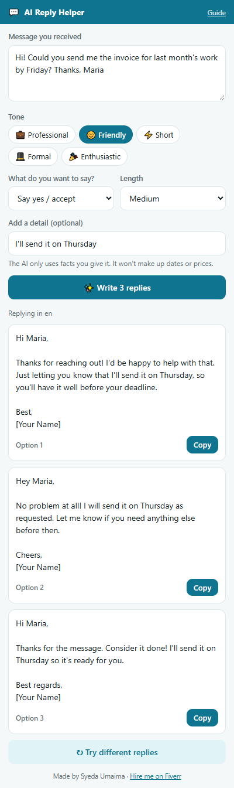

# 💬 AI Reply Helper

A Chrome extension that writes replies for you. **Select a message on any website**, pick a tone, and get **3 ready-to-send replies**. Copy the one you like and paste it.

**Live site:** _coming soon_ · Download the extension, or try it online without installing anything.

<p></p>

## Features

- **Works on any website:** select text and click the icon, or right-click → **Reply to this with AI**
- **5 tones:** Professional, Friendly, Short, Formal, Enthusiastic
- **Say what you mean:** accept, politely decline, ask for details, say thanks, or "I'll get back to you"
- **3 different replies** every time, with one-click **Copy** and **Try different replies**
- **Your facts only:** add a detail ("I'm free Friday after 2pm") and it's used; the AI never invents dates, prices or promises and writes `[date]` placeholders instead
- **Any language:** replies in the language of the message
- Remembers your favourite tone, goal and length
- **Private:** reads only the text you select, only when you ask; nothing is stored

## How it works

```
Select text ─► popup (activeTab + scripting reads the selection)
          or ─► right-click menu ─► service worker saves it ─► opens the popup
                         │
                         ▼
               POST /api/reply {message, tone, goal, length, note}
                         │
                         ▼
          FastAPI ─► Google Gemini (JSON mode) ─► 3 replies ─► Copy
```

The same reply panel (`extension/helper.js`) is used by the extension and by the website's **Try it** page.

## Install the extension

1. Download `ai-reply-helper.zip` from the website and unzip it.
2. Open `chrome://extensions` and turn on **Developer mode**.
3. Click **Load unpacked** and select the unzipped folder.
4. Pin the 💬 icon.

## Tech stack

| Part | Technology |
|---|---|
| Extension | Chrome Manifest V3, JavaScript, context menu, `activeTab` + `scripting`, `chrome.storage` |
| Backend | Python, FastAPI |
| AI | Google Gemini (free tier), JSON mode |
| Hosting | Vercel |

## Run it on your computer

1. Get a free Gemini API key at https://aistudio.google.com/apikey
2. In a terminal:
   ```bash
   git clone https://github.com/imumaimabukhari-123/ai-reply-helper.git
   cd ai-reply-helper
   python -m venv venv
   venv\Scripts\activate          # on Mac/Linux: source venv/bin/activate
   pip install -r requirements.txt
   copy .env.example .env         # on Mac/Linux: cp .env.example .env
   ```
3. Open `.env` and paste your key after `GEMINI_API_KEY=`.
4. Run `python app.py` and open http://127.0.0.1:8005
5. Load the `extension/` folder in Chrome (it uses the local server by default, see `extension/config.js`).

To build the download zip for a deployed site: `python tools/build_zip.py https://your-site.vercel.app`

## API

| Endpoint | Body | Returns |
|---|---|---|
| `POST /api/reply` | `{"message", "tone", "goal", "length", "note"}` | `{"replies": [3 strings], "language"}` |

## Need a custom extension or AI tool?

I build Chrome extensions, AI tools, Shopify stores and web apps.

**Syeda Umaima** · ✉️ [imumaimabukhari@gmail.com](mailto:imumaimabukhari@gmail.com) · [Hire me on Fiverr](https://www.fiverr.com/umaima886) · [GitHub](https://github.com/imumaimabukhari-123)
